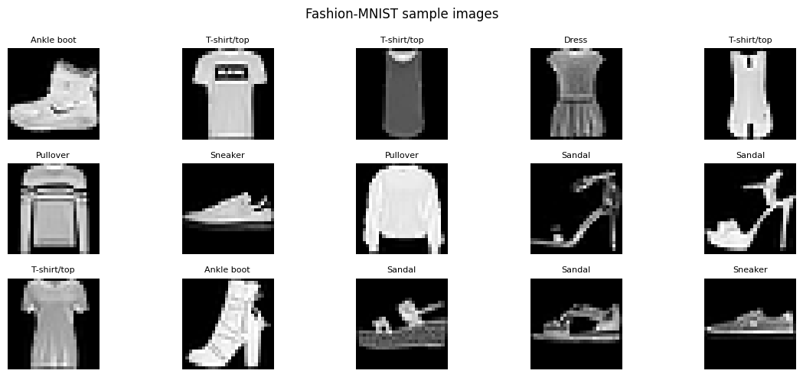
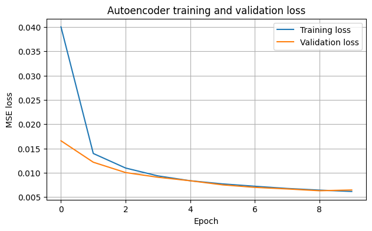
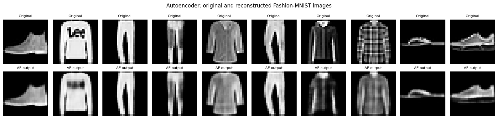
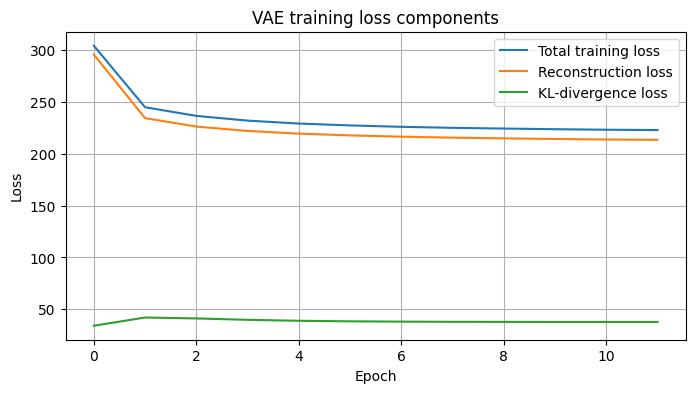
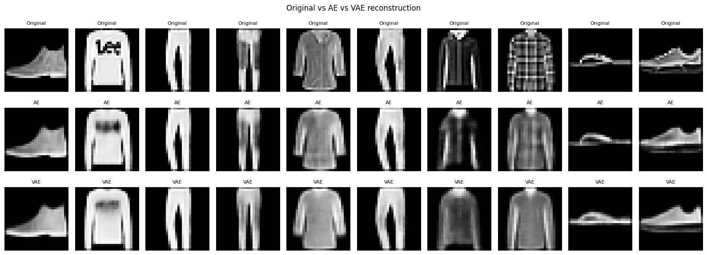
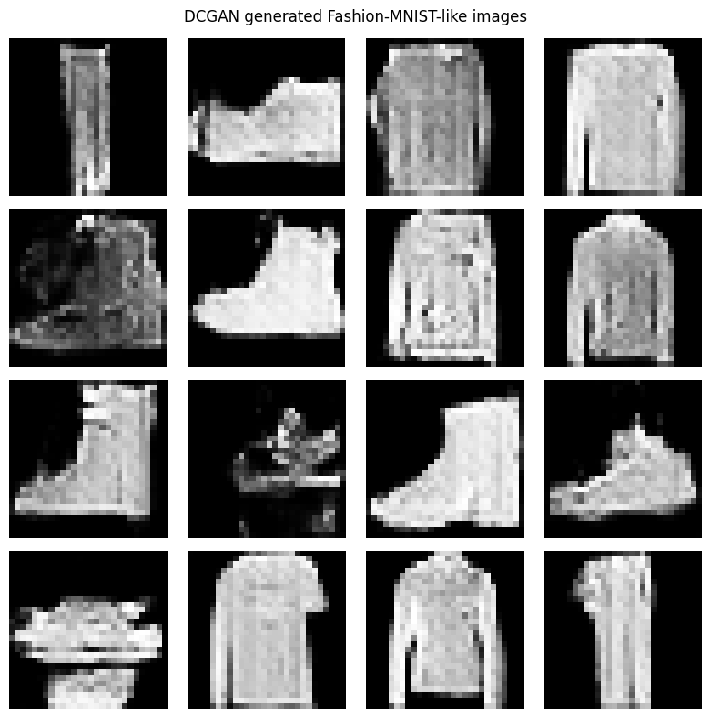
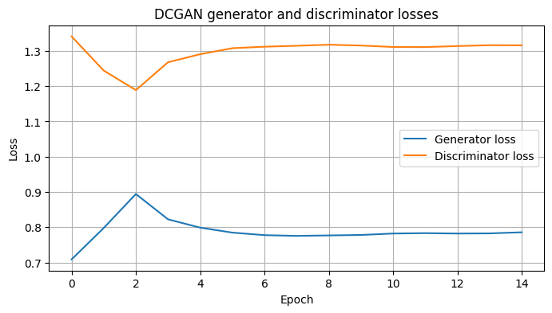
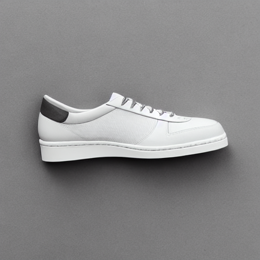

# Generative AI Lab – Assignment 02

## Comparative Study and Practical Analysis of Generative AI Models

### Image Reconstruction and Image Generation Using Autoencoder, VAE, DCGAN and Stable Diffusion

### Student Information

| Field | Details |
|---|---|
| **Student** | Shreya Dattaram Bhosale |
| **PRN** | 202502110010 |
| **Class** | T.Y. B.Tech |
| **Batch** | A3 |
| **Course** | Generative AI Lab |
| **Department** | CSE (AI & ML) |
| **Group Members** | Sakshi Walunj, Dhanashri Shah |
| **Submission Date** | 30-10-2026 |

---

## Aim

The aim of this assignment is to perform a comparative study and practical analysis of generative AI models for image reconstruction and image generation.

The practical includes Convolutional Autoencoder (AE), Variational Autoencoder (VAE), Deep Convolutional Generative Adversarial Network (DCGAN), and a pretrained Stable Diffusion model.

---

## Objectives

- Load and preprocess the Fashion-MNIST dataset.
- Understand image reconstruction using an Autoencoder.
- Implement a Variational Autoencoder and understand probabilistic latent representations.
- Implement a DCGAN for generating new images.
- Use a pretrained Stable Diffusion model for text-to-image generation.
- Visualize reconstructed and generated images.
- Plot and analyze training and validation losses.
- Compare reconstruction performance using MSE and MAE.
- Study the differences between reconstruction models and generative models.
- Document AI tools, group contributions and observations.

---

## Dataset

### Fashion-MNIST

The AE, VAE and DCGAN experiments use the Fashion-MNIST dataset.

| Dataset Property | Value |
|---|---:|
| Training images | 60,000 |
| Test images | 10,000 |
| Image dimensions | 28 × 28 |
| Channels | 1 (grayscale) |
| Number of classes | 10 |
| Pixel range after normalization | 0–1 |

The ten categories are T-shirt/top, Trouser, Pullover, Dress, Coat, Sandal, Shirt, Sneaker, Bag and Ankle boot.

### Dataset Sample Images



---

## Part A – Image Reconstruction

## 1. Convolutional Autoencoder

A convolutional Autoencoder is implemented to reconstruct Fashion-MNIST images.

### Architecture

The encoder uses convolutional layers to extract image features and compress the input into a latent vector. The decoder reconstructs the image from this latent representation.

| Parameter | Value |
|---|---|
| Input shape | 28 × 28 × 1 |
| Latent dimension | 128 |
| Optimizer | Adam |
| Learning rate | 0.001 |
| Loss function | Mean Squared Error |
| Epochs | 10 |
| Batch size | 256 |

### Training and Validation Loss



### Reconstruction Results



### Test Evaluation

| Metric | Result |
|---|---:|
| Test MSE | 0.006448 |
| Test MAE | 0.039754 |

---

## 2. Variational Autoencoder (VAE)

The VAE learns a probabilistic latent representation. The encoder predicts the mean and log variance, and the reparameterization trick is used to sample a latent vector.

### Architecture and Configuration

| Parameter | Value |
|---|---|
| Input shape | 28 × 28 × 1 |
| Latent dimension | 64 |
| Beta | 0.25 |
| Optimizer | Adam |
| Loss | Reconstruction loss + weighted KL divergence |
| Epochs | 12 |
| Batch size | 256 |

### VAE Training Curves



### Reconstruction Results



### Test Evaluation

| Metric | Result |
|---|---:|
| Test MSE | 0.009283 |
| Test MAE | 0.047689 |

---

## Part B – Image Generation

## 3. Deep Convolutional Generative Adversarial Network (DCGAN)

DCGAN is implemented to generate new Fashion-MNIST-like images.

The generator converts random noise vectors into images. The discriminator learns to distinguish real Fashion-MNIST images from generated images.

### Configuration

| Parameter | Value |
|---|---|
| Noise dimension | 100 |
| Image shape | 28 × 28 × 1 |
| Batch size | 128 |
| Epochs | 15 |
| Optimizer | Adam |
| Learning rate | 0.0002 |
| Beta 1 | 0.5 |
| Generator output activation | tanh |

### Generated Images



### Generator and Discriminator Loss



---

## 4. Pretrained Stable Diffusion

A pretrained Stable Diffusion v1.5 model is used for text-to-image generation.

Unlike AE, VAE and DCGAN, this model is pretrained and is not trained on the Fashion-MNIST dataset in this assignment.

### Prompt

> High-quality studio product photo of a single classic white sneaker, side view, isolated on light grey background, soft studio lighting, sharp details, realistic material texture.

### Negative Prompt

> Blurry, distorted, low resolution, multiple shoes, cropped object, watermark, text, logo.

### Generation Configuration

| Parameter | Value |
|---|---|
| Model | Stable Diffusion v1.5 |
| Inference steps | 20 |
| Guidance scale | 7.0 |
| Output resolution | 512 × 512 |
| CPU offloading | Enabled |
| Attention slicing | Enabled |

### Generated Image



---

## Part C – Comparative Analysis

## 5. Reconstruction Performance: Autoencoder vs VAE

The Autoencoder and VAE are compared using test-set reconstruction metrics.

| Model | Test MSE | Test MAE |
|---|---:|---:|
| Convolutional Autoencoder | 0.006448 | 0.039754 |
| Variational Autoencoder | 0.009283 | 0.047689 |

The Autoencoder achieved lower MSE and MAE in this execution, indicating lower pixel-wise reconstruction error on the test set.

The VAE additionally learns a probabilistic latent space, which supports sampling and generative use.

> Pixel-wise reconstruction metrics are appropriate for the paired reconstruction outputs of AE and VAE. They are not used to rank DCGAN or Stable Diffusion, because those models generate new images rather than reconstructing corresponding test inputs.

---

## Model Comparison

| Model | Main Purpose | Input | Output |
|---|---|---|---|
| Autoencoder | Image reconstruction | Fashion-MNIST image | Reconstructed image |
| VAE | Reconstruction and latent-space generation | Fashion-MNIST image / latent sample | Reconstructed or generated image |
| DCGAN | Adversarial image generation | Random noise vector | Generated Fashion-MNIST-like image |
| Stable Diffusion | Text-to-image generation | Text prompt and random noise | 512 × 512 generated image |

---

## Results and Discussion

- The Autoencoder learned a compact latent representation and reconstructed Fashion-MNIST images.
- The Autoencoder test MSE was 0.006448 and test MAE was 0.039754.
- The VAE learned a probabilistic latent representation and achieved test MSE of 0.009283 and MAE of 0.047689.
- The DCGAN generated new grayscale Fashion-MNIST-like samples from random noise.
- Stable Diffusion generated a sneaker image from a text prompt using a pretrained model.
- The experiments demonstrate the distinction between paired image reconstruction, unconditional image generation and text-conditioned image generation.

---

## Technologies Used

| Technology | Purpose |
|---|---|
| Python | Programming language |
| TensorFlow / Keras | Autoencoder, VAE and DCGAN implementation |
| NumPy | Numerical operations |
| Matplotlib | Plotting losses and visualizing images |
| PyTorch | Stable Diffusion model execution |
| Hugging Face Diffusers | Loading and running Stable Diffusion |
| Transformers | Model dependencies |
| Accelerate | Model execution and CPU offloading |
| Google Colab / Jupyter | Notebook execution environment |

---

## How to Run

### 1. Open the Notebook

Open `Shreya_Bhosale_Comparative_Study.ipynb` in Google Colab or a compatible Jupyter environment.

### 2. Run the Notebook Sequentially

The notebook performs the following steps:

1. Import required libraries and set random seeds.
2. Load and normalize Fashion-MNIST.
3. Display sample dataset images.
4. Build, train and evaluate the convolutional Autoencoder.
5. Display Autoencoder reconstructions and loss plots.
6. Build, train and evaluate the VAE.
7. Display VAE reconstructions and loss curves.
8. Train the DCGAN generator and discriminator.
9. Display DCGAN generated samples and loss curves.
10. Load pretrained Stable Diffusion v1.5.
11. Generate a sneaker image using the prompt and negative prompt.
12. Compare Autoencoder and VAE reconstruction metrics.

Stable Diffusion requires its model dependencies and access to the pretrained model repository. A GPU is recommended for practical execution.

---

## Project Structure

```text
Assignment_02_Comparative_Study/
│
├── Shreya_Bhosale_Comparative_Study.ipynb
├── README.md
│
└── screenshots/
    ├── 01_fashion_mnist_samples.png
    ├── 02_autoencoder_reconstruction.png
    ├── 03_autoencoder_loss.png
    ├── 04_vae_reconstruction.png
    ├── 05_vae_loss.png
    ├── 06_dcgan_generated_grid.png
    ├── 07_dcgan_losses.png
    ├── 08_stable_diffusion_output.png
    └── INDEX.md
```

The `screenshots/` directory contains the actual visual outputs exported from the executed Assignment 2 notebook. Keep this folder beside `README.md` when uploading the project to GitHub so that all relative image links work.


---

## Key Learning Outcomes

- Understanding convolutional Autoencoders.
- Understanding Variational Autoencoders and probabilistic latent spaces.
- Applying the reparameterization trick.
- Understanding reconstruction loss and KL divergence.
- Training a DCGAN generator and discriminator.
- Generating images from random noise.
- Using pretrained Stable Diffusion for text-to-image generation.
- Plotting and interpreting model training losses.
- Comparing reconstruction models using MSE and MAE.
- Understanding the differences between reconstruction and image generation.

---

## Limitations

- Fashion-MNIST contains small grayscale images and is simpler than real-world high-resolution image datasets.
- AE and VAE reconstruction quality depends on latent dimension and training configuration.
- DCGAN training can be unstable and may require further tuning.
- Stable Diffusion is pretrained and is not fine-tuned on Fashion-MNIST in this assignment.
- Generated samples from different model families are not directly comparable using paired reconstruction metrics.

## Future Scope

- Experiment with different latent dimensions and beta values for the VAE.
- Train DCGAN for more epochs and study training stability.
- Explore conditional GANs for class-specific generation.
- Fine-tune diffusion models on a domain-specific dataset.
- Use additional image quality metrics for generated samples.
- Compare generated image diversity and visual quality.

---

## Conclusion

This assignment implemented and compared four generative AI approaches: Convolutional Autoencoder, Variational Autoencoder, DCGAN and pretrained Stable Diffusion.

The Autoencoder and VAE were evaluated for image reconstruction using test-set MSE and MAE. The DCGAN generated Fashion-MNIST-like images from random noise, while Stable Diffusion generated a sneaker image from a text prompt.

The experiments provided practical understanding of latent representations, reconstruction losses, adversarial learning and text-conditioned image generation.

---

## References

1. Fashion-MNIST dataset: https://github.com/zalandoresearch/fashion-mnist
2. TensorFlow documentation: https://www.tensorflow.org/
3. Kingma, D. P. and Welling, M., “Auto-Encoding Variational Bayes,” 2013.
4. Radford, A., Metz, L. and Chintala, S., “Unsupervised Representation Learning with Deep Convolutional Generative Adversarial Networks,” 2015.
5. Hugging Face Diffusers documentation: https://huggingface.co/docs/diffusers
6. Stable Diffusion v1.5 model: https://huggingface.co/stable-diffusion-v1-5/stable-diffusion-v1-5

---

## Author

**Shreya Dattaram Bhosale**  
PRN: 202502110010  
T.Y. B.Tech – CSE (AI & ML)  
MIT Academy of Engineering, Alandi  
Generative AI Lab
