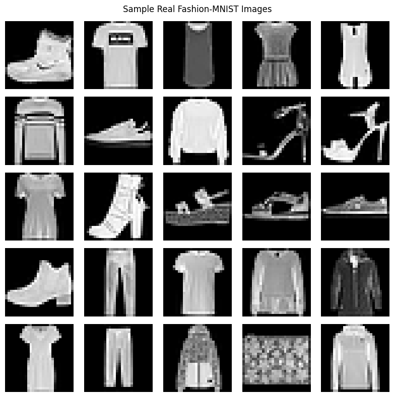
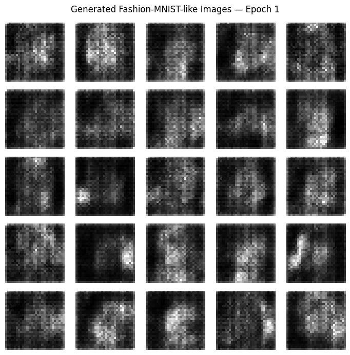
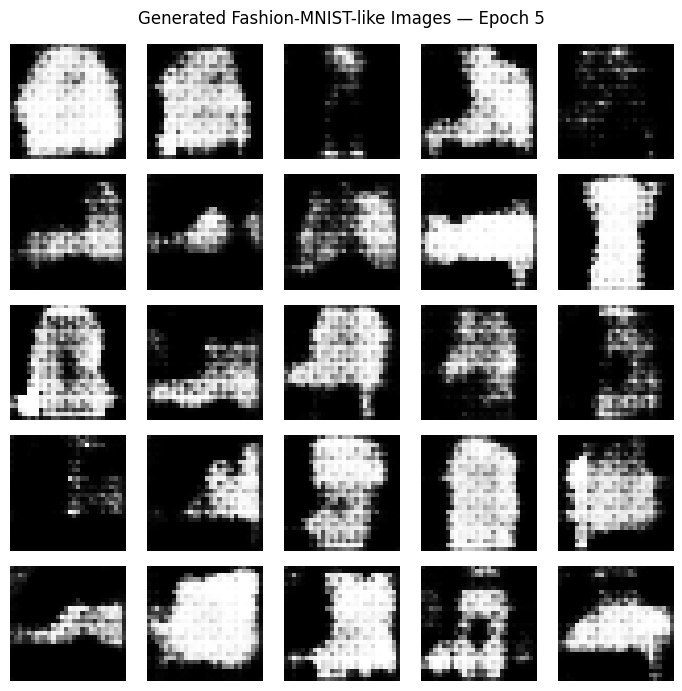
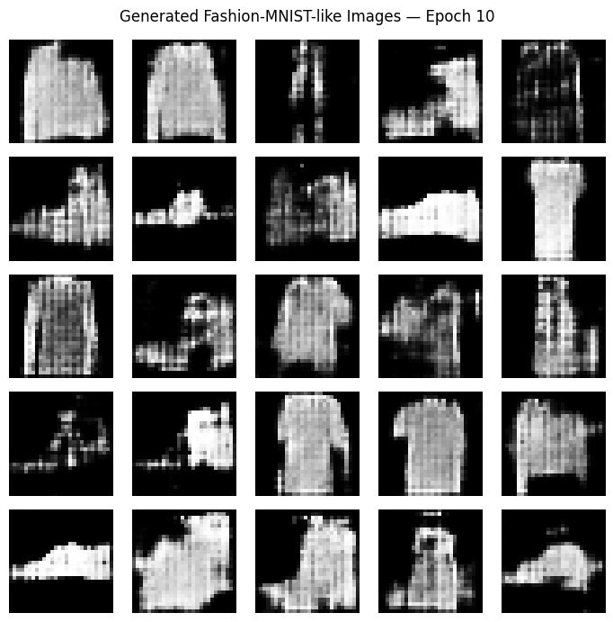
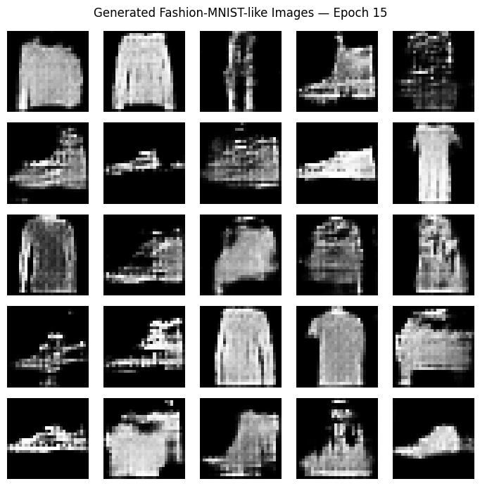
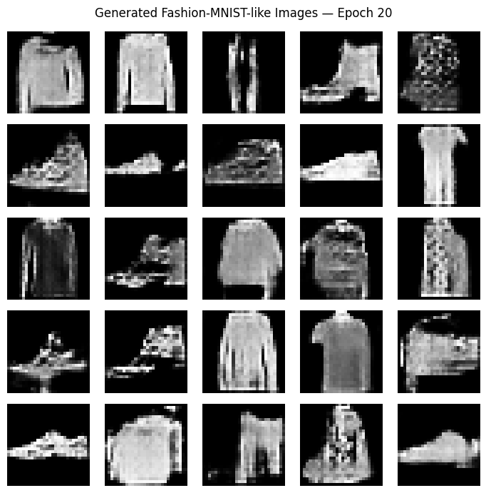
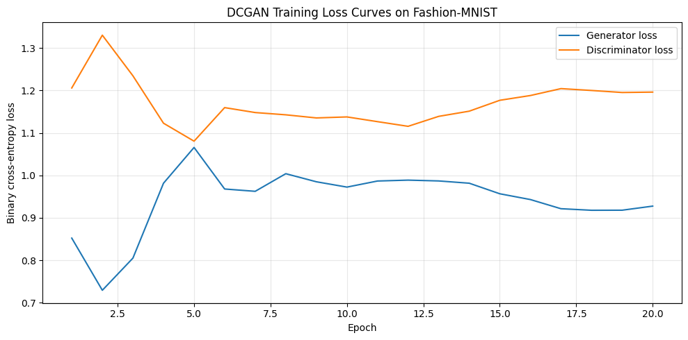

# Practical No. 04 – Image Generation Using DCGAN on Fashion-MNIST

## Student Information

| Field | Details |
|---|---|
| College | MIT Academy of Engineering, Alandi, Pune |
| Student | Shreya Dattaram Bhosale |
| PRN | 202502110010 |
| Class | T.Y. B.Tech |
| Department | CSE (AI & ML) |
| Batch | A3 |
| Course | Generative AI Lab |
| Practical | 04 |
| Submission date | 21-10-2026 |

## Aim

Implement and train a Deep Convolutional Generative Adversarial Network (DCGAN) using Fashion-MNIST to generate synthetic grayscale clothing images and evaluate its progress through generated samples and Generator/Discriminator loss curves.

## Objectives

- Prepare Fashion-MNIST images for adversarial training.
- Build a Generator that transforms random noise into images.
- Build a Discriminator that distinguishes real from generated images.
- Train both networks with binary cross-entropy and Adam optimizers.
- Compare generated samples at different epochs and examine training losses.

## Dataset and Preprocessing

**Fashion-MNIST** contains 28 × 28 grayscale clothing images from 10 categories. The notebook uses the first **20,000 training images** from the 60,000-image training split, with a 10,000-image test split loaded. Images are reshaped to `(28, 28, 1)` and normalized from 0–255 to **−1 to +1**, matching the Generator's `tanh` output.

### Real Fashion-MNIST samples



## Methodology

```text
Fashion-MNIST → Normalize to [-1, 1] → Real images ──┐
                                                     ↓
Random noise (100 dimensions) → Generator → Fake images
                                                     ↓
                             Discriminator (real/fake logits)
                                                     ↓
                         Adversarial losses and updates
                                                     ↓
                         Generated images and loss plots
```

## DCGAN Architecture

### Generator

The Generator accepts a **100-dimensional** random latent vector, projects it using a dense layer, and upsamples through transposed convolutions to produce a **28 × 28 × 1** grayscale image. Hidden layers use Leaky ReLU, while the output uses `tanh`.

### Discriminator

The Discriminator receives real or generated **28 × 28 × 1** images, extracts features using convolutional layers, and produces a real/fake logit.

### Training Configuration

| Parameter | Recorded value |
|---|---|
| Training subset | 20,000 images |
| Image shape | 28 × 28 × 1 |
| Pixel range | −1 to +1 |
| Latent/noise dimension | 100 |
| Epochs | 20 |
| Batch size | 128 |
| Loss | Binary cross-entropy (from logits) |
| Optimizer | Adam |
| Learning rate | 0.0002 |
| Adam beta₁ | 0.5 |
| Random seed | 42 |
| TensorFlow version (notebook output) | 2.21.0 |

## Visual Outputs from the Executed Notebook

The images below are **actual outputs extracted from the uploaded notebook**, not recreated examples.

### Generated images after Epoch 1



### Generated images after Epoch 5



### Generated images after Epoch 10



### Generated images after Epoch 15



### Generated images after Epoch 20



### Generator and Discriminator Training Loss Curves



### Final Generated Image Grid


## Results and Discussion

| Observation | Recorded result |
|---|---:|
| Completed training epochs | 20 |
| Final Generator loss | 0.9277 |
| Final Discriminator loss | 1.1963 |
| Generated images per displayed grid | 25 (5 × 5) |
| Training subset | 20,000 images |

The notebook shows synthetic image grids at epochs 1, 5, 10, 15 and 20, allowing visual comparison of progress during training. The loss curves illustrate the adversarial interaction between the two networks. **GAN losses can fluctuate**, so lower loss for one network alone does not guarantee better image quality. Generated-image quality should also be assessed visually. No FID or Inception Score was calculated in this notebook.

## Technologies Used

| Technology | Purpose |
|---|---|
| Python | Implementation |
| TensorFlow / Keras | Generator, Discriminator and training |
| NumPy | Numerical operations |
| Matplotlib | Real/generated image grids and loss plots |
| Google Colab / Jupyter Notebook | Execution environment |

## How to Run

1. Open `Shreya_Bhosale_DCGAN_Fashion_MNIST.ipynb` in Google Colab or Jupyter Notebook.
2. Install the dependencies if required: `pip install tensorflow numpy matplotlib`.
3. Run all cells sequentially. A GPU is recommended.
4. The notebook creates `dcgan_outputs/` for generated images, training loss plot and saved Keras models.
5. Keep `README.md` and the `screenshots/` folder at the same directory level for GitHub images to render.

## Project Structure

```text
Practical-4/
├── README.md
├── Shreya_Bhosale_DCGAN_Fashion_MNIST.ipynb
└── screenshots/
    ├── 01_fashion_mnist_real_samples.png
    ├── 02_generated_epoch_01.png
    ├── 03_generated_epoch_05.png
    ├── 04_generated_epoch_10.png
    ├── 05_generated_epoch_15.png
    ├── 06_generated_epoch_20.png
    ├── 07_generator_discriminator_loss_curves.png
    └── 08_final_generated_images.png
```

## Key Learning Outcomes

- Understood adversarial training with Generator and Discriminator networks.
- Learned how random noise is converted into synthetic clothing images.
- Used transposed convolution for image generation and convolution for discrimination.
- Examined image-generation progress across training epochs.
- Interpreted GAN loss curves together with visual outputs.

## Limitations and Future Scope

- The run uses 20,000 of 60,000 Fashion-MNIST training images and only 20 epochs.
- Generated samples may be blurry or ambiguous.
- The notebook does not compute quantitative image-quality metrics such as FID.
- Future work can use more epochs, the complete dataset and additional evaluation metrics.

## Conclusion

The DCGAN was trained for **20 epochs** on **20,000 Fashion-MNIST training images**. Its Generator produced synthetic grayscale images from random latent vectors, while the Discriminator learned to classify real and generated samples. Recorded loss curves and image grids document training progress and demonstrate adversarial image generation.

## References

1. [Fashion-MNIST dataset](https://github.com/zalandoresearch/fashion-mnist)
2. [TensorFlow documentation](https://www.tensorflow.org/)
3. Radford, Metz and Chintala, *Unsupervised Representation Learning with Deep Convolutional Generative Adversarial Networks* (2015).

## Author

**Shreya Dattaram Bhosale**  
PRN: 202502110010  
T.Y. B.Tech – CSE (AI & ML)  
MIT Academy of Engineering, Alandi  
Generative AI Lab
