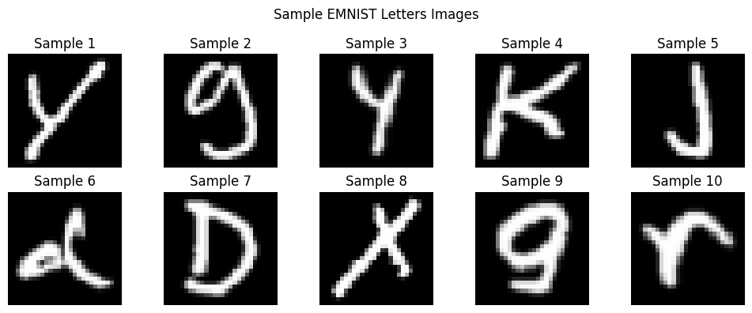
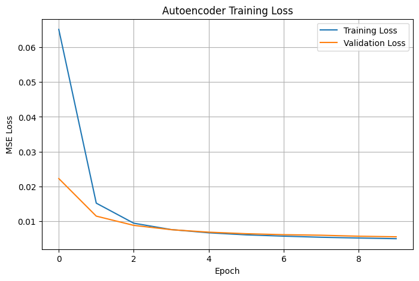
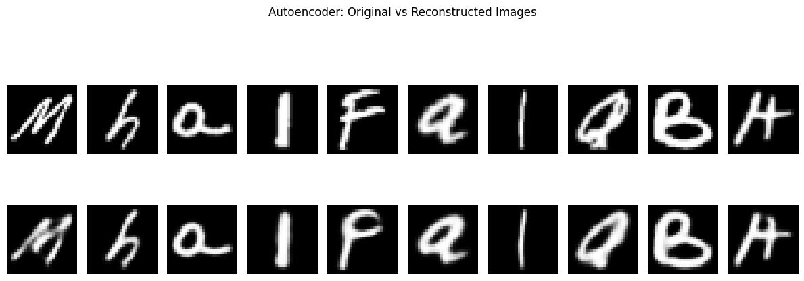
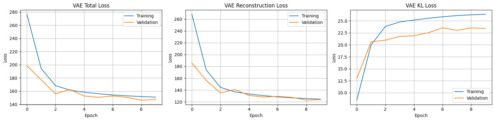
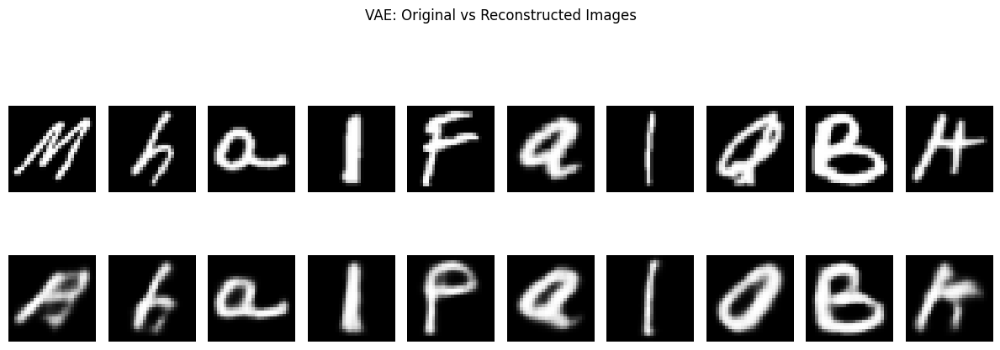
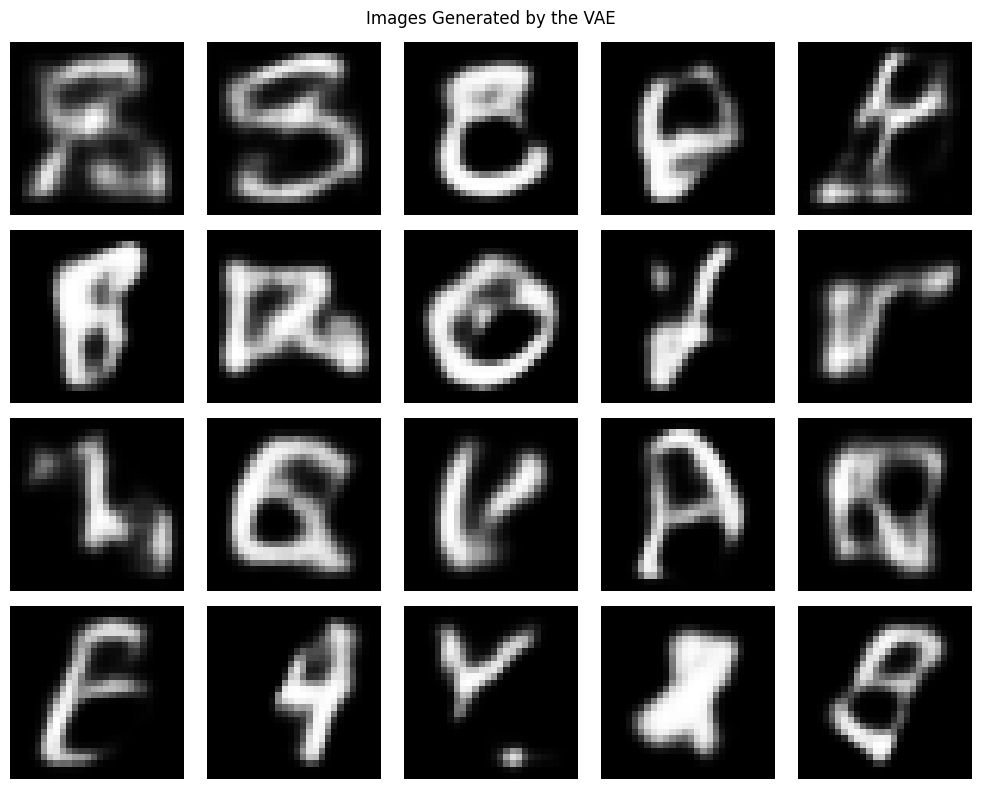
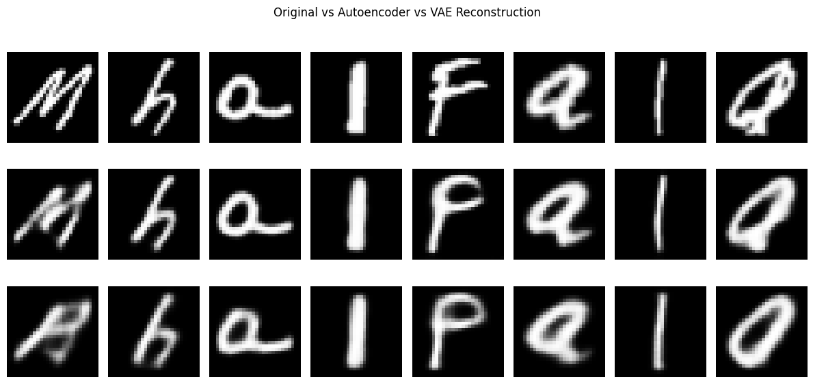
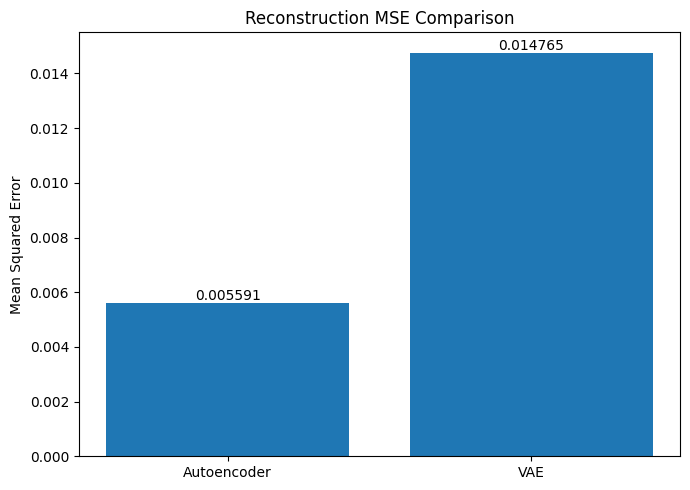

# Practical No. 03 – Autoencoder and Variational Autoencoder for Image Reconstruction

## Student Information

| **College** | MIT Academy of Engineering, Alandi, Pune |
| **Student Name** | Shreya Dattaram Bhosale |
| **PRN Number** | 202502110010 |
| **Class** | T.Y. B.Tech |
| **Batch** | A3 |
| **Course** | Generative AI Lab |
| **Department** | CSE (AI & ML) |
| **Practical Number** | 03 |
| **Submission Date** | 29/09/2026 |

---

## Aim

To implement an Autoencoder and a Variational Autoencoder (VAE) using the EMNIST Letters dataset for handwritten image reconstruction and generation, and to compare their reconstruction performance.

## Objectives

- Load and preprocess handwritten letter images from the EMNIST Letters dataset.
- Understand the encoder, latent representation and decoder components.
- Implement a convolutional Autoencoder for image reconstruction.
- Implement a Variational Autoencoder using mean, log variance and the reparameterization trick.
- Visualize original and reconstructed images.
- Generate new letter-like images by sampling from the VAE latent space.
- Compare both models using reconstruction loss, visual results and test-set MSE.

---

## Dataset

### EMNIST Letters Dataset

The practical uses the **EMNIST Letters** dataset, which contains grayscale images of handwritten English alphabet letters (A–Z).

| Dataset Property | Value |
|---|---:|
| Image dimensions | 28 × 28 pixels |
| Channels | 1 (grayscale) |
| Classes | 26 (A–Z) |
| Training subset used | 30,000 images |
| Testing subset used | 5,000 images |
| Original pixel range | 0–255 |
| Normalized pixel range | 0–1 |
| Input shape | 28 × 28 × 1 |

The labels are not required for this reconstruction task. Each input image is also used as its target output.

### Dataset Samples



---

## Data Preprocessing

The notebook performs the following preprocessing steps:

1. Load the EMNIST Letters dataset using TensorFlow Datasets.
2. Select 30,000 images for the training subset and 5,000 images for the testing subset.
3. Normalize pixel values from 0–255 to 0–1.
4. Convert the images to `float32`.
5. Ensure that each image has the shape `(28, 28, 1)`.
6. Orient the image axes for upright display.
7. Use each input image as its own target during reconstruction training.

Recorded data shapes:

```text
Training subset: (30000, 28, 28, 1)
Testing subset : (5000, 28, 28, 1)
Minimum pixel value: 0.0
Maximum pixel value: 1.0
```

---

## Methodology

The practical is divided into two model implementations followed by a comparative evaluation.

### Overall Workflow

```text
              EMNIST Letters Dataset
                         |
                         v
                 Data Preprocessing
                         |
              +----------+----------+
              |                     |
              v                     v
         Autoencoder                VAE
              |                     |
              v                     v
          Encoder               Encoder
              |                Mean / Log Variance
              v                     |
       Latent Vector                v
              |                 Sampling
              v                     |
           Decoder                  v
              |                  Decoder
              v                     |
      Reconstructed Image    Reconstructed Image
              |                     |
              +----------+----------+
                         |
                         v
                Performance Comparison
                         |
                         v
             VAE Random Image Generation
```

---

## Part A – Convolutional Autoencoder

## Autoencoder Architecture

A convolutional Autoencoder is implemented to learn a compact, deterministic representation of each input image.

### Encoder

- Accepts an input image of shape `28 × 28 × 1`.
- Uses convolutional layers to extract image features.
- Applies downsampling to reduce spatial dimensions.
- Produces a compact latent representation of dimension 32.

### Decoder

- Takes the latent representation as input.
- Uses dense, reshape and transposed-convolution operations.
- Reconstructs the image to the original `28 × 28 × 1` shape.
- Uses a sigmoid output activation because input pixels are normalized to 0–1.

### Model Summary

| Component | Details |
|---|---|
| Model type | Convolutional Autoencoder |
| Input shape | 28 × 28 × 1 |
| Latent dimension | 32 |
| Total parameters | 583,649 |
| Trainable parameters | 583,649 |
| Reconstruction loss | Mean Squared Error (MSE) |
| Optimizer | Adam |
| Epochs | 10 |
| Batch size | 128 |

### Training

The Autoencoder is trained to minimize the difference between the input image and its reconstruction.

\[
MSE = \operatorname{mean}((x-\hat{x})^2)
\]

where `x` is the original image and `x̂` is the reconstructed image.

### Autoencoder Training Graph



### Autoencoder Reconstruction Results



### Autoencoder Test Result

```text
Autoencoder Test Reconstruction MSE: 0.005591
```

---

## Part B – Variational Autoencoder (VAE)

## VAE Architecture

A Variational Autoencoder learns a probabilistic latent representation instead of mapping each input to one fixed latent vector.

The encoder produces two vectors:

- **Mean (μ):** represents the centre of the latent distribution.
- **Log variance (log σ²):** represents the spread of the latent distribution.

A latent vector is sampled using the reparameterization trick:

\[
z = \mu + \exp(0.5 \times \log(\sigma^2)) \times \epsilon
\]

where:

\[
\epsilon \sim N(0,I)
\]

This allows the latent space to be sampled and supports generation of new images.

### Encoder

- Input shape: `28 × 28 × 1`.
- Convolutional layers with 32 and 64 filters.
- Dense layer with 128 units.
- Produces `z_mean` and `z_log_var`.
- Uses a sampling layer to generate the latent vector.

### Decoder

- Latent dimension: 16.
- Dense layer followed by reshape.
- Uses transposed-convolution layers for upsampling.
- Produces a reconstructed image of shape `28 × 28 × 1`.
- Uses sigmoid activation at the output.

### Model Configuration

| Parameter | Value |
|---|---|
| Latent dimension | 16 |
| Encoder parameters | 424,480 |
| Decoder parameters | 108,993 |
| Total VAE parameters | 533,473 |
| Optimizer | Adam |
| Learning rate | 0.001 |
| Epochs | 10 |
| Batch size | 128 |

## VAE Loss Function

The VAE uses two loss components.

### 1. Reconstruction Loss

Binary cross-entropy measures how closely the reconstructed image matches the input image.

### 2. KL-Divergence Loss

KL-divergence regularizes the latent distribution so that it remains close to a standard normal distribution.

\[
KL = -0.5 \sum (1+\log(\sigma^2)-\mu^2-\sigma^2)
\]

### Total Loss

\[
L_{VAE}=L_{reconstruction}+L_{KL}
\]

## VAE Training Curves

The notebook visualizes total loss, reconstruction loss and KL-divergence loss for training and validation data.



## VAE Reconstruction Results



## VAE Test Evaluation

```text
VAE Test Total Loss          : 146.942245
VAE Test Reconstruction Loss : 123.513977
VAE Test KL Loss             : 23.428267
```

## VAE Image Generation

New images are generated by sampling 20 random latent vectors from a standard normal distribution. These vectors are passed through the trained VAE decoder to generate new letter-like images.



---

## Part C – Performance Comparison

## Autoencoder vs VAE

| Criterion | Autoencoder | Variational Autoencoder |
|---|---|---|
| Latent representation | Deterministic | Probabilistic |
| Encoder output | Latent vector | Mean and log variance |
| Sampling layer | Not required | Reparameterization trick |
| Reconstruction | Supported | Supported |
| Training reconstruction loss | MSE | Binary cross-entropy |
| KL-divergence regularization | No | Yes |
| Random image generation | Not directly supported by standard AE | Supported through latent sampling |
| Main use in this practical | Image reconstruction | Image reconstruction and generation |

## Quantitative Reconstruction Comparison

Both models are evaluated using MSE on the same test images. For the VAE, the mean latent vector is used for deterministic reconstruction during this comparison.

| Model | Test Reconstruction MSE |
|---|---:|
| Autoencoder | 0.005591 |
| VAE | 0.014765 |

**Result:** The Autoencoder achieved the lower test reconstruction MSE in this execution. A lower MSE indicates a smaller average pixel-wise reconstruction error.

> The training objectives are different: the Autoencoder is trained with MSE, while the VAE uses binary cross-entropy reconstruction loss plus KL-divergence. The common test-set MSE is used here to compare pixel-wise reconstruction quality; the VAE total loss is reported separately.

### Side-by-Side Reconstruction Comparison



### Reconstruction MSE Graph



---

## Results and Discussion

- The Autoencoder learned a deterministic latent representation and reconstructed the EMNIST letter images.
- The Autoencoder achieved a test reconstruction MSE of **0.005591**.
- The VAE learned a probabilistic latent representation using mean, log variance and the reparameterization trick.
- The VAE achieved a test reconstruction MSE of **0.014765** when its mean latent vector was used for reconstruction.
- The VAE test total loss was **146.942245**, consisting of reconstruction loss **123.513977** and KL loss **23.428267**.
- The VAE generated 20 new letter-like images by decoding randomly sampled latent vectors.
- In this run, the Autoencoder produced lower pixel-wise reconstruction error, while the VAE additionally demonstrated random image generation.

---

## Technologies Used

| Technology | Purpose |
|---|---|
| Python | Programming language |
| TensorFlow | Deep learning framework |
| Keras | Model implementation and training |
| TensorFlow Datasets | Loading the EMNIST Letters dataset |
| NumPy | Numerical operations and latent sampling |
| Matplotlib | Visualizing samples, losses and reconstructions |
| Google Colab / Jupyter Notebook | Notebook execution environment |

### Recorded Environment Versions

| Library | Version |
|---|---|
| TensorFlow | 2.21.0 |
| NumPy | 2.1.3 |
| TensorFlow Datasets | 4.9.10 |

---

## How to Run

### 1. Install Dependencies

```bash
pip install tensorflow tensorflow-datasets numpy matplotlib
```

### 2. Open the Notebook

Open `Practical_03_Autoencoder_VAE_EMNIST_Letters.ipynb` in Google Colab or a Jupyter environment.

### 3. Run the Notebook

Run all cells sequentially. The notebook will:

1. Install/import the required libraries.
2. Load the EMNIST Letters dataset.
3. Prepare and normalize the image data.
4. Display sample dataset images.
5. Build and train the convolutional Autoencoder.
6. Plot Autoencoder training loss.
7. Display Autoencoder reconstructions.
8. Evaluate Autoencoder test MSE.
9. Build the VAE encoder, sampling layer and decoder.
10. Train the VAE and plot its loss components.
11. Display VAE reconstructions.
12. Evaluate VAE test losses.
13. Generate new letter-like images.
14. Compare both models using test-set MSE.
15. Display side-by-side reconstructions and the MSE comparison graph.

---

## Project Structure

```text
Practical_03_Autoencoder_VAE_EMNIST/
│
├── Practical_03_Autoencoder_VAE_EMNIST_Letters.ipynb
├── README.md
│
└── screenshots/
    ├── 01_4_data_preprocessing.png
    ├── 02_7_autoencoder_training.png
    ├── 03_7_autoencoder_training_02.png
    ├── 04_10_vae_training.png
    ├── 05_10_vae_training_02.png
    ├── 06_11_vae_image_generation.png
    ├── 07_comparison_criteria.png
    ├── 08_comparison_criteria_02.png
    └── INDEX.md
```

The `screenshots/` directory contains the actual visual outputs exported from the executed notebook. The README uses relative image paths, so keep the folder beside `README.md` when uploading to GitHub.

---

## Key Learning Outcomes

- Understanding Autoencoders and their encoder-decoder architecture.
- Understanding convolutional image reconstruction.
- Learning how latent representations compress input images.
- Understanding probabilistic latent representations in VAEs.
- Applying the reparameterization trick.
- Understanding reconstruction loss and KL-divergence.
- Visualizing training and validation loss curves.
- Reconstructing handwritten letter images.
- Generating new images through latent-space sampling.
- Comparing model outputs using a common reconstruction metric.

---

## Limitations

- The experiment uses selected subsets of EMNIST Letters rather than the complete dataset.
- The images are small grayscale images of size 28 × 28.
- Reconstruction quality depends on model architecture, latent dimension and training configuration.
- VAE-generated samples may not always resemble clearly recognizable letters.
- A lower reconstruction MSE does not measure the diversity or generative quality of newly generated samples.

## Future Scope

- Train on larger portions or the full EMNIST Letters dataset.
- Experiment with different latent dimensions.
- Tune model depth, batch size and learning rate.
- Explore conditional VAEs for class-specific letter generation.
- Compare additional generative models.
- Evaluate generated image quality using additional metrics.

---

## Conclusion

The convolutional Autoencoder and Variational Autoencoder were implemented using the EMNIST Letters dataset for handwritten image reconstruction. The Autoencoder learned a deterministic latent representation, while the VAE learned a probabilistic representation using mean, log variance and the reparameterization trick.

Both models reconstructed handwritten letter images and were evaluated on the same test subset using MSE. In the recorded execution, the Autoencoder achieved a lower test reconstruction MSE of **0.005591**, compared with **0.014765** for the VAE. The VAE also demonstrated image generation by sampling random points from its latent space.

The practical provided hands-on experience with image preprocessing, convolutional encoders and decoders, latent-space learning, reconstruction losses, KL-divergence and generative image sampling.

---

## References

1. **EMNIST: An Extension of MNIST to Handwritten Letters.** Cohen et al., 2017.
2. TensorFlow Documentation: https://www.tensorflow.org/
3. TensorFlow Datasets – EMNIST: https://www.tensorflow.org/datasets
4. Keras Documentation: https://keras.io/

---

## Author

**Shreya Dattaram Bhosale**  
PRN: 202502110010  
T.Y. B.Tech – CSE (AI & ML)  
MIT Academy of Engineering, Alandi  
Generative AI Lab
